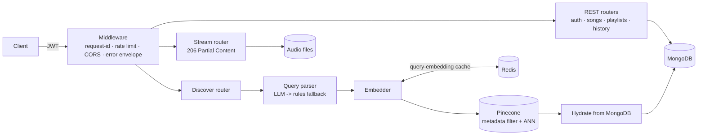

# AI Audio Streaming & RAG Discovery Pipeline

A backend that turns natural-language requests ("upbeat electronic music for a morning workout") into
ranked, filtered playlists using Retrieval-Augmented Generation, and streams the audio with HTTP Range
requests. Python · FastAPI · Pinecone · Redis · MongoDB · JWT.



## What it demonstrates

| Capability | Where | How it works |
|---|---|---|
| RAG discovery | `app/rag/service.py`, `query_parser.py`, `vector_store.py` | An LLM (optional) turns the request into `semantic_text` + hard filters (genre, mood, tempo/energy/valence/danceability ranges). The semantic text is embedded and searched in Pinecone with the filters pushed down as a metadata `filter`. Results are hydrated from MongoDB in rank order. If filters are too narrow they relax step by step (`relaxation_level` in the response) instead of returning nothing. |
| LLM safety | `query_parser.py` | The request is treated as untrusted data. LLM output is parsed defensively, clamped, and restricted to the catalogue's real genres/moods. Any failure falls back to a deterministic rule-based parser, so the endpoint works with no LLM at all. |
| REST APIs | `app/routers/*` | Resource-oriented routes under `/api/v1`, correct verbs and status codes (201/204/401/403/404/409/413/415/416/422/429), Pydantic validation, paginated envelopes, ownership checks (private playlists return 404 to non-owners). |
| Range streaming | `app/routers/stream.py`, `app/streaming.py` | `GET`/`HEAD` with `Range` -> `206` + `Content-Range`; out-of-range -> `416`; malformed/multi-range -> full `200` (allowed by RFC 9110). Fixed-size chunk generator, so memory per request is one chunk regardless of file size. ETag / `If-None-Match` / `If-Range`. Also accepts `?token=` because `<audio>` cannot set headers. |
| Middleware pipeline | `app/middleware.py`, `app/errors.py`, `app/deps.py` | Pure-ASGI request-id + timing + JSON access log; Redis-backed fixed-window rate limiter with separate `auth` / `stream` / `api` buckets and `Retry-After`; one JSON error envelope for every failure path, including unhandled exceptions (no stack traces leak). |
| Auth | `app/security.py`, `app/routers/auth.py` | bcrypt (SHA-256 pre-hash so long passphrases aren't truncated at 72 bytes), run off the event loop; JWT with `exp`/`iat`/`jti`; same error for unknown email and wrong password, with a dummy hash check to blunt timing-based enumeration; admins are never self-registered. |
| Caching | `app/rag/embeddings.py`, `app/cache.py` | Query embeddings are cached in Redis as raw float32 bytes keyed by a hash of the normalised query and embedder name. Everything fails open to an in-process cache if Redis is down. |
| MongoDB | `app/db.py`, `app/routers/history.py` | Indexes declared per access pattern (compound, unique, text with weights, descending sort), created idempotently at startup. Listening history with `$group`/`$lookup`/`$unwind` aggregations for top genres and tracks. |
| Consistency | `routers/songs.py`, `rag/indexer.py` | MongoDB is the source of truth; creating a song rolls the insert back if indexing fails; deletes clean up the vector, playlist references and audio file. `POST /discover/reindex` rebuilds the index. |
| Upload safety | `routers/songs.py` | Streamed to disk in 1 MB chunks, size-capped, magic-byte checked (not just extension), written to a temp file then atomically renamed, server-generated filenames (no path traversal). |

## Quick start

```bash
cp .env.example .env                       # then set PINECONE_API_KEY (or VECTOR_BACKEND=memory EMBEDDING_BACKEND=hash to run offline)
docker compose up -d mongo redis           # or point MONGO_URI / REDIS_URL at your own
pip install -r requirements.txt
python -m scripts.seed                     # 24 tracks, playable demo audio, vector index, demo users
uvicorn app.main:app --reload
```

Open <http://localhost:8000/docs>, log in as `demo@example.com` / `DemoPass123!` (created by the seed script,
local development only), click **Authorize**, then:

```bash
TOKEN=$(curl -s localhost:8000/api/v1/auth/login -H 'content-type: application/json' \
  -d '{"email":"demo@example.com","password":"DemoPass123!"}' | python -c 'import sys,json;print(json.load(sys.stdin)["access_token"])')

# RAG discovery (and save the result as a playlist)
curl -s localhost:8000/api/v1/discover -H "authorization: Bearer $TOKEN" -H 'content-type: application/json' \
  -d '{"query":"upbeat electronic music for a morning workout","limit":5,"save_as_playlist":true}'

# Range request: first 1 KB of a track -> 206 Partial Content
SONG=$(curl -s "localhost:8000/api/v1/songs?limit=1" -H "authorization: Bearer $TOKEN" | python -c 'import sys,json;print(json.load(sys.stdin)["items"][0]["id"])')
curl -si localhost:8000/api/v1/stream/$SONG -H "authorization: Bearer $TOKEN" -H 'Range: bytes=0-1023' -o /dev/null -D -
```

Or run everything in containers: `docker compose up --build`.

## API overview

| Method & path | Auth | Purpose |
|---|---|---|
| `POST /api/v1/auth/register`, `/login` | – | Create account, get JWT |
| `GET/PATCH/DELETE /api/v1/auth/me` | user | Profile; delete also removes playlists and history |
| `GET /api/v1/songs` | user | Search (`q`), filter (`genre`, `mood`, tempo range), sort, paginate |
| `GET /api/v1/songs/facets`, `/{id}` | user | Genres/moods; single song |
| `POST/PATCH/DELETE /api/v1/songs[/{id}]` | admin | Manage catalogue (keeps vector index in sync) |
| `POST /api/v1/songs/{id}/audio` | admin | Upload audio |
| `GET/HEAD /api/v1/stream/{id}` | user | Range-aware audio streaming |
| `GET/POST /api/v1/playlists`, `GET/PATCH/DELETE /{id}`, `POST /{id}/songs`, `DELETE /{id}/songs/{song_id}` | user | Playlist CRUD (public/private) |
| `POST /api/v1/discover` | user | **RAG: natural language -> playlist** |
| `GET /api/v1/discover/stats` | user | Embedding-cache hit rate, index size |
| `POST /api/v1/discover/reindex` | admin | Rebuild vector index |
| `POST/GET /api/v1/history`, `GET /history/stats` | user | Listening log and aggregations |
| `GET /healthz`, `/readyz` | – | Liveness / readiness (Mongo, Pinecone, Redis) |

Every discovery response includes `interpreted` (what the parser understood), `relaxation_level`,
`embedding_cache_hit` and per-stage `timings_ms`, so the pipeline is observable from the client.

## Measuring performance

```bash
python -m scripts.benchmark --rounds 20
```

Runs the pipeline in-process (LLM off) and prints p50/p95 for three variants: no cache + post-filtering,
+ Redis embedding cache, + metadata pre-filtering. Quote the numbers you measure on your own data rather
than a fixed percentage; the small seed catalogue mostly shows the cache effect, and filter pushdown only
matters at larger scale.

## Tests

```bash
pip install -r requirements-dev.txt
pytest
```

`test_streaming`, `test_query_parser`, `test_embeddings` need no services. `test_security` covers bcrypt/JWT.
`test_api` runs the real app end to end against in-memory fakes (mongomock-motor, in-process cache,
in-memory vector index, offline hash embedder): auth, RBAC, upload validation, 200/206/416/HEAD streaming,
discovery and cache hits, rate limiting, error envelope.

## Design notes and trade-offs

- **Embeddings**: default is Pinecone Inference (`multilingual-e5-large`, 1024-d): real semantic matching with
  no local model. Tracks are embedded as `passage`, searches as `query`. `EMBEDDING_BACKEND=hash` is lexical
  only and exists for offline tests and demos. Each backend gets its own Pinecone index (the embedder name is
  appended to `PINECONE_INDEX`) so vectors of different models and dimensions can't mix.
- **Pinecone is eventually consistent**: a freshly upserted track can take a few seconds to appear in search
  results, and the `indexed_songs` count lags the same way. The first start creates the serverless index and
  blocks until it is ready.
- **Offline dev**: `VECTOR_BACKEND=memory EMBEDDING_BACKEND=hash` needs no Pinecone key; the index is rebuilt
  from MongoDB on every boot.
- **Rate limiting** is a fixed window, which allows short bursts at window edges; a sliding window or token
  bucket would be the next step. Behind a proxy, set `TRUST_PROXY_HEADERS=true` only if you control that proxy.
- **JWTs** are stateless access tokens (no refresh/revocation list). Fine for this scope; production would add
  refresh tokens and a denylist keyed on `jti`.
- **Streaming** serves local disk. Swapping in object storage means replacing `iter_file` with ranged GETs.
- **Single-range only**: multi-range requests fall back to a full response.
